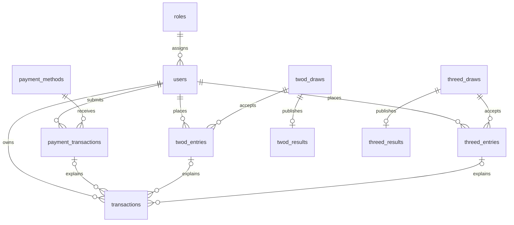

# Database structure for the existing 2D/3D app

Reviewed: 2026-10-16. Companion files: [implementation plan](IMPLEMENTATION_PLAN.md) and [project guidance](skill.md).

## Design boundary and current evidence

Keep the current domain model: `users.balance` for spendable funds, `transactions` for wallet movements, `payment_transactions` for payment requests, and separate 2D and 3D draw/entry/result tables. A second wallet or a generic replacement betting schema would duplicate code already written.

The tables below describe the intended repaired schema and proposed extensions. They are **not a claim that the connected database currently has these tables**. This review inspected source files, Git deletion status, and route output; it did not inspect or modify the live database.

| Area | What exists in this working tree | Required action |
| --- | --- | --- |
| Users and roles | UUID models and create-table migrations exist | Restore the missing `users.role_id` migration or an equivalent reviewed migration |
| Payment tables and ledger | Models, factories, controllers, and an additive workflow migration exist | Repair the missing base create-table migrations before running the additive migration |
| 2D/3D entries and results | Models and factories exist; the game workflow migration adds columns | Repair the missing base create-table migrations |
| Draws | UUID models, factories, and create-table definitions exist in the game workflow migration | Reuse these definitions; implement services and routes later |
| Infrastructure | Sessions, password reset tokens, personal access tokens, cache, and jobs migrations exist | Preserve their framework-specific key conventions |

The deleted base migrations are for `transactions`, `payment_methods`, `payment_transactions`, `twod_entries`, `threed_entries`, `twod_results`, and `threed_results`. The deleted role migration is `2026_10_09_051034_add_role_id_column_to_user_table.php`. Their deletion is visible through `git status`; no deletion was repaired as part of this documentation task.

Historical base definitions in Git used numeric IDs for at least the transaction table, while the current domain models use `HasUuids`. Restoring historical files unchanged would therefore leave a type mismatch. Decide whether the project has deployed databases before choosing a repair strategy.

## Common column and relationship rules

| Concern | Target rule |
| --- | --- |
| Domain primary keys | UUID primary key; generated by the current Eloquent UUID convention |
| Domain foreign keys | UUID with the same physical type as the referenced primary key |
| Amounts | Unsigned bigint, whole MMK; positive for a movement or stake, zero allowed for balance and unpaid payout |
| API numeric range | Preserve the current service ceiling of `9,007,199,254,740,991`; validate arithmetic before writing |
| Existing payment limit | Current request validation permits `1..1,000,000,000` MMK per request; do not silently reuse it as a betting policy |
| Payout multipliers | `decimal(12,4)` as already defined; validate positive values; calculate without binary floating point |
| Numbers | String length 2 for 2D and 3 for 3D, validated as exactly that many ASCII digits |
| Time | Persist instants consistently in UTC; convert business draw dates and session cutoffs using one explicitly configured timezone |
| Deletion | Preserve financial history; restrict deleting referenced users, draws, entries, and payments |
| Source history | Snapshot the values needed to explain an accepted payment or entry even if settings later change |
| Timestamps | Domain tables have `created_at` and `updated_at`; use `settled_at`, `reviewed_at`, and `published_at` for their distinct events |

The business timezone is a decision to confirm. The machine timezone is not enough evidence to choose the draw timezone. The current migration's `unsigned()` on a decimal is not a cross-database guarantee against negative values; enforce valid multipliers in application validation and supported database constraints.

## Core relationships

Each ledger movement has exactly one source: a payment, a 2D entry, or a 3D entry. The diagram permits nullable source columns individually; the service and, where supported, a database check must enforce that exactly-one rule.

## 1. `roles` — keep

| Column | Type / constraint | Notes |
| --- | --- | --- |
| `id` | UUID PK | Current migration |
| `name` | String, unique | Current seed names: Super Admin, Admin, Branch Manager, Staff, Customer |
| `status` | `active`, `inactive` | Current authorization checks active status |
| `deleted_at` | Nullable timestamp | Soft deletion |
| Timestamps | Timestamp columns | Existing migration uses timezone-aware Laravel methods |

Keep `User::isAdministrator()` behavior for Super Admin and Admin. The other seeded roles currently have no branch or agent schema behind them.

## 2. `users` — keep and repair role link

| Column | Type / constraint | State |
| --- | --- | --- |
| `id` | UUID PK | Existing create migration |
| `role_id` | UUID FK to `roles.id`, indexed | Required by auth/model/factories; its migration is deleted |
| `name` | String | Existing |
| `email` | String, unique | Existing login identifier |
| `email_verified_at` | Nullable timestamp | Existing |
| `password` | String, hashed through the existing model cast | Existing |
| `remember_token` | Nullable string | Existing framework convention |
| `balance` | Unsigned bigint, default 0 | Added by the payment workflow migration |
| Timestamps | Timestamp columns | Existing |

Prefer restricted deletion for referenced roles; the historical role migration used cascading user deletion, which is unsuitable once users own financial history. This is a proposed correction, not the current migration behavior. For existing users without roles, backfill reviewed assignments before making `role_id` required.

The video shows a phone value on the signed-in home card. For visual parity, propose a nullable normalized `phone` string (for example, length 32) as a profile field, with uniqueness only if the business requires it. Phone login, OTP, referral codes, user suspension, and separate customer profiles require their own confirmed requirements. Do not replace email authentication based only on that card.

## 3. `payment_methods` — keep

| Column | Type / constraint |
| --- | --- |
| `id` | UUID PK; repair missing base definition |
| `name` | String |
| `account_name` | String |
| `account_number` | String(100), preserving leading zeroes |
| `instructions` | Nullable text |
| `status` | `active`, `inactive`; default active, indexed |
| `deleted_at` | Nullable timestamp |
| Timestamps | Required by existing models and queries |

Use the existing soft-delete behavior and `PaymentTransactions::paymentMethod()->withTrashed()` so deleting a method does not remove payment history. Provider accounts and customer withdrawal destinations remain distinct: the latter are snapshots on payment requests.

## 4. `payment_transactions` — keep

| Column | Type / constraint |
| --- | --- |
| `id` | UUID PK; repair missing base definition |
| `user_id` | UUID FK to users, restrict deletion |
| `payment_method_id` | UUID FK to payment methods, restrict deletion |
| `client_reference` | Nullable UUID; existing per-user idempotency key |
| `type` | `deposit`, `withdrawal` |
| `amount` | Unsigned bigint |
| `status` | `pending`, `approved`, `rejected`, `cancelled`; default pending |
| `account_name` | String snapshot |
| `account_number` | String(100) snapshot |
| `reference_number` | Nullable string(100); required for deposits by current request rules |
| `note`, `review_note` | Nullable string(1000) |
| `reviewed_by` | Nullable UUID FK to users; current migration nulls it on user deletion |
| `reviewed_at` | Nullable timestamp |
| Timestamps | Required |

Existing intended indexes:

- Unique `(user_id, client_reference)`.
- Unique `(payment_method_id, reference_number)`.
- Index `(user_id, status, created_at)`.
- Index `(status, created_at)`.

Keep null `reference_number` for withdrawals. Check nullable unique-index semantics on the chosen database engine before deploying; the existing design expects multiple null references to be allowed. Case sensitivity and normalization of bank reference numbers must match the provider's meaning.

The current idempotency key is optional. Clients omitting it have no request-key replay guarantee. The plan proposes requiring it for retryable writes without silently changing existing clients.

## 5. `transactions` — keep as the wallet ledger

| Column | Type / constraint |
| --- | --- |
| `id` | UUID PK; repair missing base definition |
| `user_id` | UUID FK to users, restrict deletion |
| `payment_transaction_id` | Nullable UUID FK, restrict deletion |
| `twod_entry_id` | Nullable UUID FK, restrict deletion |
| `threed_entry_id` | Nullable UUID FK, restrict deletion |
| `type` | `deposit`, `withdrawal`, `withdrawal_refund`, `bet`, `win`, `bet_refund` |
| `amount` | Positive unsigned bigint, absolute movement amount |
| `balance_before` | Unsigned bigint |
| `balance_after` | Unsigned bigint |
| Timestamps | Required |

Existing intended indexes:

- Unique `(payment_transaction_id, type)`.
- Unique `(twod_entry_id, type)`.
- Unique `(threed_entry_id, type)`.
- Index `(user_id, created_at)`.

| Movement | Source | Balance arithmetic |
| --- | --- | --- |
| `deposit` | Approved deposit request | `after = before + amount` |
| `withdrawal` | Newly submitted withdrawal | `after = before - amount` |
| `withdrawal_refund` | Rejected/cancelled withdrawal | `after = before + amount` |
| `bet` | Accepted game entry | `after = before - amount` |
| `win` | Winning settled entry | `after = before + amount` |
| `bet_refund` | Cancelled eligible entry/draw | `after = before + amount` |

Payment movement code already exists. Game movement code does not. A losing entry needs no zero-value ledger movement. Reject mismatched source/type combinations and source records belonging to another user. Do not edit or delete posted movements to correct a result; a correction requires a separately designed audited reversal policy.

All balance writers must take the owner lock and follow the same arithmetic/range policy. Pending withdrawal debits must remain refundable. When refundable bets are introduced, extend the existing overflow protection to include those obligations as well. `users.balance` and the ledger must be reconcilable; any legacy starting balance needs an explicit migration/reconciliation decision rather than an unexplained ledger gap.

`TransactionResource` currently exposes the payment source only. Extend it to expose the appropriate game entry reference, and extend `ListTransactionsRequest` to permit game movement filters when those phases ship.

## 6–7. `twod_draws` and `threed_draws` — reuse existing definitions

| Column | Type / constraint | Difference |
| --- | --- | --- |
| `id` | UUID PK | Both |
| `draw_date` | Date | Business calendar date |
| `session` | `morning`, `evening` | 2D only |
| `opens_at` | Timestamp | Both |
| `closes_at` | Timestamp | Both |
| `draws_at` | Timestamp | Both |
| `payout_multiplier` | Decimal(12,4) | Both |
| `status` | `scheduled`, `open`, `closed`, `settled`, `cancelled` | Both |
| Timestamps | Timestamp columns | Both |

Existing uniqueness is `(draw_date, session)` for 2D and `draw_date` for 3D. Both index `(status, closes_at)`. Keep those constraints unless confirmed requirements introduce multiple providers or more sessions; that change would need an explicit identity extension.

Validate `opens_at < closes_at <= draws_at`. Availability requires an accepting status **and** the current server instant inside the acceptance window. A delayed scheduler must not extend betting past `closes_at`.

Proposed small additions, after the core services are agreed: nullable `settled_at`, nullable `cancelled_at`, and nullable `cancellation_reason`. They support operations and history; they are not present in the current draw migration. Do not add a `settling` status without also defining recovery from partial settlement.

## 8–9. `twod_entries` and `threed_entries` — reuse and complete

| Column | Type / constraint |
| --- | --- |
| `id` | UUID PK; repair missing base definitions |
| `user_id` | UUID FK to users, restrict deletion |
| `draw_id` | UUID FK to the matching game's draws, restrict deletion |
| `client_reference` | Nullable UUID, unique with user ID |
| `number` | String(2) for 2D; string(3) for 3D |
| `amount` | Positive unsigned bigint |
| `payout_multiplier` | Decimal(12,4), frozen when the entry is accepted |
| `payout_amount` | Unsigned bigint, default 0; credited award on a winning settlement |
| `status` | `pending`, `won`, `lost`, `cancelled`; default pending |
| `settled_at` | Nullable timestamp |
| Timestamps | Required |

Both intended entry tables have unique `(user_id, client_reference)`, index `(user_id, created_at)`, and index `(draw_id, number, status)`. The user may legitimately buy the same number more than once; do not make `(user_id, draw_id, number)` unique.

One accepted entry maps to one stake debit. A settled winner maps to at most one `win` credit. A cancelled entry maps to at most one `bet_refund`. The unique source/type constraints protect retries, while transactions and row locks protect state transitions.

**Batch gap:** the video shows a 3D entry list, total, number helper, and multiline import screen. The current schema stores one request key per entry and cannot use the same per-user key for several entries. For one confirmed multi-number purchase, use the slip-header extension below with one database transaction covering all its entries. A frontend loop does not provide all-or-nothing checkout.

## 10–11. `twod_results` and `threed_results` — reuse and complete

| Column | Type / constraint |
| --- | --- |
| `id` | UUID PK; repair missing base definitions |
| `draw_id` | UUID FK to the matching draw, unique, restrict deletion |
| `number` | String(2) for 2D; string(3) for 3D |
| `recorded_by` | Nullable UUID FK to users, currently null-on-delete |
| `published_at` | Nullable timestamp |
| Timestamps | Required |

One result per draw is already the intended constraint. Result entry and settlement are separate operations: recording a number must not create an unguarded duplicate payout. Keep the published result immutable after settlement until an audited correction workflow is explicitly designed.

For large draws, introduce a settlement job/run design only when needed. Each entry transition and wallet movement must commit atomically, retries must skip completed entries, and the draw becomes settled only when all eligible entries are terminal. A small synchronous transaction is simpler initially but must have a bounded supported size.

## Framework tables — preserve

Keep `personal_access_tokens`, `sessions`, `password_reset_tokens`, `cache`, `cache_locks`, `jobs`, `job_batches`, `failed_jobs`, and Laravel's migration repository. The current token migration uses a UUID primary key and UUID morphs to the token owner, supported by `App\Models\PersonalAccessToken`. Preserve that customization. Other framework tables retain their existing numeric or string keys. Authentication already stores access/refresh token pairs in the Sanctum table and distinguishes their abilities and session names.

## Extensions needed to match the recorded screens

These are proposed additions, not tables already implemented. Apply them after the Phase 0 repairs. The reference timestamps and scope limits are in the implementation plan.

### A. Saved withdrawal accounts — Phase 2

The 00:45–00:46 screen selects a customer withdrawal account and offers an add-account action. Keep these accounts separate from merchant receiving accounts in `payment_methods`.

Proposed `user_payment_accounts`:

| Column | Type / constraint | Purpose |
| --- | --- | --- |
| `id` | UUID PK | Saved destination identifier |
| `user_id` | UUID FK to users, restrict deletion | Owner |
| `provider_code` | String(50) | Enabled provider such as a configured KBZ Pay/Wave Pay code |
| `account_name` | String | Destination name |
| `account_number` | String(100) | Destination number; normalized without losing leading zeroes |
| `deleted_at` | Nullable timestamp | Remove a saved choice without deleting payment history |
| Timestamps | Timestamp columns | Maintenance history |

Add an owner lookup index and, if duplicate destinations should be prevented, unique `(user_id, provider_code, account_number)`. Define restore/update behavior for soft-deleted duplicates before adding that uniqueness rule.

Propose `payment_methods.provider_code` as an indexed string(50) so multiple merchant receiving accounts can be grouped under one provider button. Validate saved-account providers against enabled provider configuration/methods. If provider lifecycle needs independent administrator management, introduce `payment_providers` and foreign keys as a later normalization; the current recording does not require that extra catalog table.

Propose nullable `payment_transactions.user_payment_account_id` as a UUID foreign key, with restricted deletion while referenced or null-on-delete only if immutable snapshots are preserved. On a new withdrawal, resolve an account owned by the authenticated user, verify provider compatibility, and copy its destination details into the existing `account_name`/`account_number` columns. Retain the existing direct-account-field API for compatibility if it has callers. Replays must resolve the original accepted request before consulting mutable saved-account details, so an edit cannot change an earlier transfer or reserve twice.

### B. Atomic game receipts — Phase 5, and Phase 4 if required for 2D

Add `threed_bet_slips` for the demonstrated 3D checkout. Add an equivalent `twod_bet_slips` only if the approved 2D flow also submits multiple numbers together. Keep existing entry tables as the individual wagers.

| Slip column | Type / constraint |
| --- | --- |
| `id` | UUID PK |
| `user_id` | UUID FK to users, restrict deletion |
| `draw_id` | UUID FK to the matching game draw, restrict deletion |
| `client_reference` | Required UUID |
| `request_hash` | String(64), hash of canonical validated draw and ordered number/amount lines |
| `total_amount` | Positive unsigned bigint, recomputed on the server |
| `entries_count` | Positive unsigned integer |
| Timestamps | Timestamp columns |

Use unique `(user_id, client_reference)` and an owner-history index `(user_id, created_at)`. Keep a slip within one draw. The header records an accepted purchase; settlement state can be derived from its entries instead of maintaining a second conflicting status.

Extend the matching entries table with nullable UUID `bet_slip_id` and nullable unsigned integer `line_number`, unique together. New batch entries require both values. Nullable columns let existing single-entry records remain valid until a reviewed backfill is needed. For batch entries, leave their legacy per-entry `client_reference` null and use the slip's key for purchase idempotency. Preserve that per-entry key for single-entry requests.

Checkout locks/rechecks the draw and wallet, validates every line, checks the total, creates the header and entries, and records each entry's stake debit within **one database transaction**. Apply the wallet debit exactly once per entry, whose sum equals `total_amount`; do not also insert a second aggregate debit. On failure, the entire purchase rolls back. On retry, compare the canonical payload with the stored request hash and return the same receipt or a conflict. Preserve repeated numbers if the customer explicitly requests separate lines; do not silently deduplicate them.

Multiline text and number-generation controls are input helpers. Parse them into a bounded explicit list of digit-string/amount pairs, show invalid lines and the calculated total, and require purchase confirmation. An import preview needs no accepted-bet table and must not reserve funds. Revalidate cutoff, balance, limits, and entries at checkout even if a preview was valid earlier.

### C. Results and small home-screen features — Phases 4–7

The dated 2D list at 02:15/02:19 can be built by joining results to draws and grouping by `draw_date`, with morning/evening slots. A missing session result is null/unpublished, not `00`. The dated 3D list at 02:17–02:18 uses the existing one-result-per-draw relationship. No duplicate daily-result summary tables are necessary.

The banner displays 85 for 2D and 550 for 3D, while factories use 80 and 500. The reference also displays 2D cutoffs 11:55 AM/03:55 PM and a 3D cutoff 02:00 PM. Confirm the business rules and timezone; then populate draw rows and snapshot their payout multipliers on entries. Do not treat promotional text, factory values, or the workstation timezone as the settlement authority.

Balance visibility, refresh, amount presets, keypad controls, tabs, and navigation are UI state. Help contact information can be configuration. If administrators must manage campaigns, a later `banners` table can contain UUID ID, title, asset path, optional destination, active dates, status, display order, and timestamps. That table is optional; seeing a banner does not establish a campaign-management requirement.

## Migration sequence and existing data

### Fresh development database

1. Review the deleted migrations and restore or replace their base definitions with UUID primary keys and timestamps.
2. Ensure roles exist before adding the users role foreign key.
3. Create payment methods, payment requests, ledger, and game entry/result bases before additive migrations reference them.
4. Apply the existing payment workflow migration after its bases exist.
5. Apply the existing game workflow migration, which creates draws before adding entry/result draw foreign keys and ledger game references.
6. Seed roles and test through factories on a disposable database.

This is a proposed implementation sequence. No `migrate:fresh` command was run or requested for the user's current database.

### Database with existing records or applied migrations

1. Inventory the migration repository, actual column types, foreign keys, row counts, and existing identifier values using read-only checks.
2. Restore migration history for repeatable installs. Applied migrations will not rerun merely because their files are edited.
3. If records still use numeric IDs, design an additive UUID mapping/backfill for every referencing column, verify it, and switch constraints and application reads together. Do not cast numeric IDs or UUID text into each other.
4. Backfill required role and ownership values before tightening nullability; verify financial balances and source references.
5. Use new forward migrations for deployed schema changes, with a backup and a reviewed rollback strategy before applying them.

## Acceptance checks for the schema phase

- Fresh migration and seeding work in the isolated test database.
- Every domain relationship has matching UUID column types and valid referenced rows.
- Existing authentication and payment tests pass after the route/request fixes in Phase 0.
- Duplicate source/type movements and duplicate non-null request keys cannot be inserted.
- Leading-zero numbers survive a complete write/read cycle.
- Target-database tests verify nullable uniqueness, constraints, and competing balance writes; SQLite alone cannot verify production locking.

These are planned checks. No application tests or database migrations were run for the documentation-only change.
