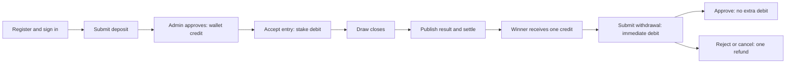

# Implementation plan for the existing 2D/3D app

Reviewed: 2026-10-16. Read with [DATABASE_STRUCTURE.md](DATABASE_STRUCTURE.md) and [skill.md](skill.md).

## Objective

Extend the app already written into a complete customer flow: register, sign in, request a deposit, receive administrator approval, place a 2D or 3D entry, view results and winnings, request a withdrawal, and inspect payment and wallet history. Compare the reference recording with the actual repository before adding features.

The reference is `0-02-06-c9b48f0fd1a4ad8c5c1b85fc97521df5dcc658062816ba57c5bbe01a56bff0ff_109fa1d8daeac781.mp4` in the repository root. Its measured duration is 02:22.756; the filename's `02-06` is not its duration.

This deliverable is a plan and schema design. Existing source code is not proof of a working installation: several migration files are deleted, request validation still disagrees with UUID models, and the currently loaded routes differ from `routes/api.php`. No phase below is marked complete merely because a class exists.

## Video observations compared with the current app

The visual review used frames at five-second intervals across the recording, then closer samples around deposits, withdrawals, game helpers, and result tabs. Times below refer to the recording timeline. Audio was not transcribed. UI labels and example results establish what is displayed, not whether a transfer, accepted bet, or settlement succeeded.

| Video time | Visible behavior | Current repository comparison | Phase / database effect |
| --- | --- | --- | --- |
| 00:00–00:03; 00:52–00:55 | Signed-in home with a name/phone, hidden balance, refresh/visibility controls, deposit/withdraw/history/help shortcuts, and 2D/3D navigation | User and wallet API code exists; full home UI and a phone profile field do not | Phases 1, 3, 7; reuse user/balance; phone is a profile extension if needed |
| 00:00–00:03 | Banner displays **2D: 85**, **3D: 550** | Draw factories use **80** and **500** | Confirm actual multipliers before Phases 4–5; never calculate payouts from banner text |
| 00:06–00:09 | Deposit form with amount presets 5,000/10,000/50,000/100,000, KBZ Pay/Wave Pay choices, receiving-account selection, and Transaction Code field | Payment methods, account snapshots, amounts, and deposit references already exist | Phase 2; group existing receiving accounts by provider; presets remain UI values |
| 00:15–00:43; 00:49–00:50 | Deposit/withdrawal history tabs show empty/loading states | `GET /api/payments` already supports type/status/date filters | Phases 2–3, 7; no separate table for each tab |
| 00:45–00:46 | Withdrawal page asks the customer to select a saved account and has an add-account action; list is empty | Existing withdrawals accept destination account fields per request; no saved-account model/table | Phase 2 extension: `user_payment_accounts`; preserve payment snapshots |
| 00:57 | 2D session selector displays cutoffs **11:55 AM** and **03:55 PM**, with closed/unavailable states | `twod_draws` already supports session, times, and status; no customer draw API | Phase 4; use draw rows and confirm timezone/calendar |
| 01:00–01:08; 01:15–02:10 | 3D entry screen with number/amount inputs, keypad (`0`, `00`, `000`, `R`, delete, ENTER), entry list/total area, date, and **02:00 PM** cutoff | 3D models exist; no placement/cart API or UI implementation | Phases 5, 7; digit strings and server-owned totals; batch receipts for atomic checkout |
| 01:10 | Number-generation modal with number/amount fields and a toggle | No equivalent parsing/expansion code | Phases 5, 7; confirm exact reverse/permutation/repeated-digit semantics before implementing |
| 01:12 | Multiline text-entry/import screen with examples and a validation/continue action | No import/preview code | Phases 5, 7; preview explicit normalized entries, confirm total, then submit a batch |
| 02:15; 02:19 | Dated 2D results grouped into morning/evening values; leading-zero examples include `05`, `01`, and `00` | Separate draw/result models can supply this view once read endpoints exist | Phases 4, 7; join/group existing rows, no daily-summary table required |
| 02:17–02:18 | Dated 3D results, including `701`, `640`, `212` | 3D draw/result models can supply this list | Phases 5, 7; retain three-digit strings |
| Throughout home/results | Help shortcut, banner, navigation, and loading/empty states | No full customer app or managed-content backend | Phase 7; use configuration/static assets first; optional banners table only for managed campaigns |

The recording begins signed in. Registration, login, successful deposit submission, withdrawal account creation, an accepted bet, administrator review, and a winning wallet credit are **not demonstrated** in the reviewed screens. They are necessary implementation/acceptance flows derived from the app's purpose and existing code. The 2D entry screen is not demonstrated; the 3D keypad does not prove identical 2D rules. An unrelated Android notification around 00:48 is not an application feature.

## Existing work to reuse

Installed versions were checked through Composer: Laravel **13.35.0**, Sanctum **4.3.3**, Scribe **5.11.0**, Pest **5.3.1**, Pest Laravel plugin **5.0.1**, and Pint **1.32.1**. Use the project's PHP **8.5** executable; the shell's default `php` points to PHP 8.4 in this environment. `package.json` contains the Laravel/Vite frontend setup; no Angular application was found in this checkout.

| Capability | Existing source | Assessment |
| --- | --- | --- |
| Register, login, refresh, logout | `AuthController`, `AuthService`, auth Form Requests, `IAuthService` | Reuse; verify after schema and route repairs |
| Access and refresh token separation | Sanctum abilities, custom UUID `PersonalAccessToken`, token session names | Reuse; tests already describe rotation and per-session logout |
| Roles | `Role`, `RoleSeeder`, `User::isAdministrator()`, `EnsureAdministrator` | Reuse active Admin/Super Admin checks |
| Payment methods | Admin `PaymentMethodController`, `PaymentMethod`, requests/resources/factory | Reuse CRUD and soft deletion |
| Deposit and withdrawal review | Customer `PaymentController`, admin `TransactionController`, `PaymentService` | Substantial implementation exists; blocked by migration/UUID inconsistencies |
| Balance and history | `users.balance`, `Transaction`, `WalletController`, API Resources | Reuse the one balance and ledger |
| Draw definitions | `TwodDraw`, `ThreedDraw`, factories, game workflow migration | Schema/model groundwork; no game endpoints or services |
| Entries and results | `TwodEntry`, `ThreedEntry`, `TwodResult`, `ThreedResult` and factories | Schema/model groundwork; placement and settlement remain to implement |
| Automated coverage | `AuthApiTest.php`, `PaymentWorkflowTest.php` | Existing tests are useful requirements; not run in this documentation task |
| API documentation | Scribe config, `.scribe/endpoints`, generated resources | Reuse generator, but refresh inaccurate auth/validation information |
| Customer/admin application UI | Laravel welcome route and frontend build setup | Full customer/admin screens are not implemented in this checkout |

## Phase 0 — make the existing foundation consistent

**Dependency:** first. **Outcome:** a reproducible schema and routes that match the written code.

- [ ] Inspect whether any database with real data or applied migrations must be preserved before deciding the migration repair strategy.
- [ ] Repair the seven missing domain create-table migrations and the missing users role-column migration listed in the database document. Match the current UUID models; historical numeric base definitions cannot simply be restored unchanged.
- [ ] Ensure base tables exist before the payment/game additive migrations run, and roles exist before their user foreign key is added.
- [ ] Change numeric route constraints in `routes/api.php` to match UUID payment, transaction, and payment-method IDs.
- [ ] Replace integer-only `payment_method_id` validation in `StorePaymentRequest` with UUID validation and retain the service's active-method check.
- [ ] Fix `PaymentService::ensureMatchingRequest()` to compare UUID IDs as strings; it currently casts the submitted method ID to an integer.
- [ ] Inspect cached routes/config. The read-only route command currently lists login, register, refresh, and user routes, but omits the source file's logout/payment/wallet/admin endpoints. Clear or rebuild the appropriate caches during implementation and recheck routes; do not treat the cached list as the intended contract.
- [ ] Ensure cached configuration cannot override isolated test settings when migrations/tests are run.
- [ ] Check factories against the repaired UUID schema, including existing legacy factory aliases before removing or replacing anything.

**Acceptance:** fresh migrations and seeding work on a disposable database; source and loaded routes agree; the existing authentication and payment feature tests pass, including UUID detail/review routes and payment retries.

**Files to start with:** `routes/api.php`, `StorePaymentRequest.php`, `PaymentService.php`, `database/migrations`, and the existing two feature test files. The complete column design and deployed-data strategy are in [DATABASE_STRUCTURE.md](DATABASE_STRUCTURE.md).

## Phase 1 — finish and verify authentication

**Dependency:** Phase 0. **Reuse:** `AuthService`, `AuthController`, Sanctum, roles, `ResponseModel`.

- [ ] Retain existing email/password registration and sign-in as the initial contract.
- [ ] Verify registration assigns only the active Customer role and ignores caller-supplied role or balance values.
- [ ] Verify real HTTP status codes agree with response payloads.
- [ ] Verify access/refresh separation, expiration, token rotation, invalidated old pairs, and logout for only the current session.
- [ ] Return the authenticated user's role and balance without password or token database fields.
- [ ] Preserve throttles already declared on login/register/refresh.
- [ ] If matching the home card, add a nullable normalized phone profile field and expose only the signed-in customer's value. A displayed phone number is not evidence that phone/OTP login is required.
- [ ] Confirm whether profile editing, password recovery, phone login, or account suspension is required before adding those interfaces.

**Acceptance:** the existing `AuthApiTest` passes and expired/invalid tokens cannot reach wallet or administrative operations. Seeded role names alone do not grant unimplemented branch features.

## Phase 2 — finish deposits and withdrawals

**Dependency:** Phases 0–1. **Reuse:** existing payment controllers, requests, resources, and `PaymentService`; do not create a second payments subsystem.

- [ ] Verify administrator CRUD for payment methods and customer visibility of active methods only.
- [ ] Verify deposit submission stores the transfer reference and account snapshot without increasing the balance.
- [ ] Verify approval credits a deposit once; rejected/cancelled deposits never credit.
- [ ] Verify a withdrawal immediately reduces spendable balance and creates its debit movement.
- [ ] Verify withdrawal approval makes no second debit; rejection/cancellation refunds exactly once.
- [ ] Preserve the rejection note and reviewer identity/time.
- [ ] Preserve per-user request-key idempotency and duplicate bank-reference protection. Decide how to require a key for new clients while preserving any existing callers.
- [ ] Verify ownership isolation, active administrator authorization, insufficient funds, and conflicting final statuses.
- [ ] Define what administrator approval of a withdrawal means operationally: the current service does not send money to a bank or payment gateway. Record approval only at the agreed transfer stage.
- [ ] For video parity, add customer-owned saved withdrawal accounts and CRUD/select endpoints. Resolve account ownership/provider server-side and copy the selected details into the payment request so later account edits do not alter history.
- [ ] Group receiving accounts under provider choices such as KBZ Pay/Wave Pay. Add a small provider-code field to existing methods if sufficient; introduce a provider table only if providers need independent management.

**Acceptance:** `PaymentWorkflowTest` passes, and target-database concurrency checks show repeated approval, cancellation, and simultaneous withdrawal requests cannot create extra money or an overdraft.

**Database:** reuse `payment_methods`, `payment_transactions`, `transactions`, and `users.balance`; add `user_payment_accounts` for the saved-account screen as detailed in the database document. Receipt file upload or provider integration requires a separate confirmed scope; neither is established by the current payment code or the reviewed deposit screens.

## Phase 3 — complete wallet and customer history

**Dependency:** Phase 2. **Reuse:** `WalletController`, ledger resources, query filters and pagination.

- [ ] Define balance as spendable MMK; pending withdrawal amounts are already deducted.
- [ ] Keep payment request history distinct from wallet movement history, so pending deposits are not mistaken for credited money.
- [ ] Keep customer history scoped to the authenticated owner even if a `user_id` filter is supplied.
- [ ] Return before/after balances and the source reference for each movement.
- [ ] Extend transaction filters and resources for `bet`, `win`, and `bet_refund` as betting is implemented. The current request filter only accepts the three payment movement types.
- [ ] Define date filters in the chosen business timezone and paginate with a stable tie-breaker.
- [ ] Provide a reconciliation check for stored balance versus ledger movements, with an explicit policy for any existing starting balances.

**Acceptance:** a deposit, withdrawal, rejection refund, and later betting settlement each appear once with the correct arithmetic; another customer's records remain inaccessible.

## Phase 4 — implement the complete 2D flow

**Dependency:** Phases 0–3 and confirmed timezone, cutoff, stake, and payout rules. **Reuse:** all `Twod*` models and the existing transaction source fields.

### Draws and number selection

- [ ] Implement administrator draw creation/update and customer read endpoints for current/upcoming draws and published results.
- [ ] Preserve morning/evening session identity and unique `(draw_date, session)`.
- [ ] Show the reference's 11:55 AM / 03:55 PM cutoffs only after the business timezone/calendar is agreed; store the actual times per draw.
- [ ] Enforce `opens_at < closes_at <= draws_at` and reject betting at or after the server cutoff even if a scheduler has not updated status.
- [ ] Keep 2D numbers as two-digit strings from `00` through `99`.
- [ ] Treat reverse/permutation number selection as a list of explicit entries if required; do not add separate game tables for a UI selection shortcut.

### Entry placement and settlement

- [ ] Add Form Requests, API Resources, a customer controller, and a service in the existing directories; keep controllers thin.
- [ ] Lock/recheck the draw and user balance inside a transaction, validate the stake, copy the current payout multiplier, create the entry, debit the wallet, and insert one `bet` ledger movement atomically.
- [ ] Accept a request key, return the same accepted entry on an identical retry, and reject changed-payload key reuse.
- [ ] Define whether checkout buys one number or an atomic batch before designing its request. The existing per-entry request-key schema cannot represent a shared key on many entries.
- [ ] Let an authorized administrator record one winning number per draw and settle it only after betting is closed.
- [ ] Mark each pending entry won/lost, record the settlement time, and credit winners once through the same wallet accounting rules.
- [ ] Implement whole-draw cancellation/refunds if required. Customer entry cancellation must follow an explicit cutoff policy; do not expose an unconditional refund route.
- [ ] Serialize placement, draw closure, settlement, and cancellation to prevent late entries and duplicate payouts.

**Acceptance:** funded customer buys `07`, sees the debit and pending entry, receives one win credit after result `07`, sees the result/history, and can withdraw through the Phase 2 workflow. Losing entries do not credit a wallet. Closed-draw, insufficient-funds, unauthorized-result, retry, and cancellation paths are tested.

**Suggested new files:** a 2D customer/admin controller, placement/draw/result Form Requests, entry/draw/result Resources, and a game service under the existing `app/Service` convention. Generate concrete filenames with Artisan during implementation after checking sibling conventions.

## Phase 5 — implement 3D using the same guarantees

**Dependency:** Phase 4's wallet and settlement invariants. **Reuse:** `Threed*` models, factories, draw definitions, and source columns.

- [ ] Use exactly three-digit strings from `000` through `999`.
- [ ] Preserve current unique draw-date identity until multiple 3D draws per date are a confirmed requirement.
- [ ] Confirm the actual 3D draw calendar, cutoffs, multiplier, and any permutation rules. Factory examples are not approved business rules.
- [ ] Reconcile the reference's 02:00 PM cutoff and 550 banner with the factory's 11:55 cutoff and 500 multiplier. These are concrete differences, not values to copy into production without confirmation.
- [ ] Implement the demonstrated keypad, number-expansion helper, and multiline import as explicit entry generation. Report invalid lines and generated entries/totals before purchase; do not silently accept ambiguous shorthand.
- [ ] For the demonstrated entry-list checkout, add `threed_bet_slips` and link entries to a receipt so one confirmed batch is accepted and debited atomically. Keep single-entry compatibility if that API is implemented first. Add a 2D equivalent only if its checkout also needs batches.
- [ ] Implement draw reads, customer entries/history, administrator results, settlement, and cancellation with the same retry and accounting guarantees as 2D.
- [ ] Extract shared arithmetic or locking helpers where they reduce duplicated logic while keeping the current separate game tables.

**Acceptance:** the same funded-customer flow works for a leading-zero number such as `007`, and a 2D result cannot settle or credit a 3D entry.

## Phase 6 — administrator operations and reporting

**Dependency:** Phases 2–5. **Reuse:** existing admin controllers and active-role middleware.

- [ ] Provide queues for pending deposits/withdrawals and filters for status, customer, and date.
- [ ] Provide draw/result management, settlement status, and cancellation reasons.
- [ ] Aggregate stakes and payouts from entries and posted ledger movements; calculate accepted stakes separately from refunded stakes.
- [ ] Provide customer payment, bet, and movement lookup with authorization and pagination.
- [ ] Capture who changed a draw/result and when. Existing payment review/result recorder columns provide partial attribution; they are not a complete audit trail.
- [ ] If needed, add an audit-event table for important administrator actions and a read-only reconciliation/report view. Confirm retention requirements before implementation.
- [ ] Introduce queued settlement only if draw size needs it; define retry recovery, per-entry completion, and when the draw becomes terminal.

**Acceptance:** administrators can operate the complete lifecycle and explain each wallet movement from its source. Customer and inactive-role users cannot access these controls. Results cannot be silently overwritten after settlement.

Branch ownership, agent credit, commissions, and multiple merchant/provider balances are separate extensions. Existing seeded role names do not establish those requirements.

## Phase 7 — integrate the reference application's customer screens

**Dependency:** stable contracts from the preceding phases and the video comparison below.

- [ ] Connect login/register, balance, deposits, withdrawals, game selection, purchase confirmation, results, and history to the completed API.
- [ ] Keep number selection and temporary cart state on the client until a purchase is submitted; accept only server-computed totals and rules.
- [ ] Display server cutoff/status, pending payment state, and settlement state clearly.
- [ ] Reuse retry keys on network retries and reload the authoritative balance/history after a completed action.
- [ ] Add optional content models only for confirmed managed content. Static labels and navigation do not each require a database table.
- [ ] Group 2D results by date with morning/evening slots and provide a dated 3D list. Preserve leading zeroes and distinguish unavailable/unpublished results from a winning zero.
- [ ] Implement hidden-balance and refresh controls in the UI; obtain the balance from the existing wallet API. Configure the help destination without inventing a support-ticket subsystem.
- [ ] Work in the actual frontend repository when identified. This checkout does not establish that an Angular frontend exists here.

**Acceptance:** the visible customer journey follows the approved reference behavior, and displayed balances/results match backend records after reload and retry.

## Phase 8 — complete scenario verification and delivery

**Dependency:** all implemented scope above.

- [ ] Run the existing authentication/payment tests and add focused feature coverage for each new domain behavior.
- [ ] Check competing placements and settlement/payment retries on the target database engine. SQLite tests do not prove row-level lock behavior.
- [ ] Use existing Scribe generation for the agreed routes, correcting authentication metadata, required fields, UUID examples, states, and error responses first. Keep generated OpenAPI/Postman outputs derived from the same source.
- [ ] Reuse the generated collection for repeatable customer/admin scenarios where useful; no new Postman workspace or publication is necessary just to plan or test locally.
- [ ] Verify deployment migration order, cache rebuilding, scheduling, and any queue worker requirements against the implemented features.
- [ ] Record checks actually run, known gaps, and the final scope. After feature tests pass, ask the user to run the complete suite as required by `AGENTS.md`.

**Acceptance:** a new isolated installation and the full customer/admin scenario work; no orphaned entries, unexplained balance changes, duplicate credits, or late accepted bets remain in the covered flows.

## API contracts: keep existing paths, add game paths

All paths below include `/api`. Existing source routes remain the compatibility baseline even while the runtime route cache is stale. New game endpoints are proposals, not currently available APIs. Domain route parameters are UUIDs.

| Area | Existing source contract | Planned work |
| --- | --- | --- |
| Authentication | `POST /api/auth/register`, `/login`, `/refresh`, `/logout`; `GET /api/user` | Verify and document; retain current auth response envelope |
| Wallet | `GET /api/wallet`, `/api/wallet/transactions` | Add game references and movement filters |
| Customer payments | `GET /api/payment-methods`; `GET/POST /api/payments`; `GET /api/payments/{payment}`; `POST /api/payments/{payment}/cancel` | Fix UUID handling; preserve existing behavior |
| Saved withdrawal accounts | Proposed `GET/POST /api/payment-accounts`; `PATCH/DELETE /api/payment-accounts/{account}` | Owner-scoped operations; snapshot selected details on a withdrawal |
| Admin payment methods | Existing resource routes under `/api/admin/payment-methods` | Fix UUID constraints; retain soft deletion |
| Admin review/history | `GET /api/admin/transactions`, `/{transaction}`; `GET /api/admin/payments`, `/{payment}`; `PATCH /api/admin/payments/{payment}/status` | Reuse current review service |
| 2D customer | Proposed `GET /api/twod/draws`, `/draws/{draw}`, `/results`; `GET/POST /api/twod/entries`; `GET /api/twod/entries/{entry}` | Phases 4 and 7 |
| 3D customer | Proposed equivalent `/api/threed/...` paths | Phase 5 |
| Batch checkout / import | Proposed `POST /api/threed/entry-previews`; `POST /api/threed/bet-slips`; `GET /api/threed/bet-slips/{slip}` | Preview does not debit or persist accepted entries; checkout revalidates every line and is atomic |
| Game admin | Proposed `POST /api/admin/{game}/draws`; `PATCH /api/admin/{game}/draws/{draw}`; `PUT .../{draw}/result`; `POST .../{draw}/settle`; `POST .../{draw}/cancel` | Explicit `twod` and `threed` route groups, not an unrestricted model selector |

Proposed single-entry request: required UUID `draw_id`, exact-width digit string `number`, positive integer `amount`, and required UUID `client_reference`. Proposed batch request: required draw and request key plus an `entries` array of normalized number/amount pairs; cap its size and revalidate the total on the server. The server determines owner, status, multiplier, payout, and total debit. Preview/import syntax must be documented separately from accepted entry storage.

Proposed game response: `data` containing the accepted entry/draw resource, with a message when useful. Return `201` for a new accepted entry and `200` for an identical replay. Use `401` for missing/expired authentication, `403` for insufficient ability/role, `404` for inaccessible customer-owned records, `422` for invalid inputs/insufficient funds, and `409` for changed-payload key reuse or conflicting draw/settlement state. Paginated reads follow existing Resource pagination conventions. These are agreed-contract proposals to implement and test, not promises of current behavior.

Keep present unversioned routes compatible. Introducing `/api/v1` across the app would be a separate client migration, not a prerequisite for finishing these features.

## State and accounting rules

- Payments move from `pending` to `approved`, `rejected`, or `cancelled`. An identical final-state retry may return the existing record; a different final transition conflicts.
- Draws move from `scheduled` to `open`, then `closed`, then `settled`; cancellation is a separate controlled terminal path. A cancelled or settled draw accepts no entries.
- Entries move from `pending` to `won`, `lost`, or `cancelled`. A settled entry cannot be refunded or paid again through the ordinary path.
- Each debit/credit and source transition commit together. Take compatible locks in a documented order across all services, keep transactions bounded, and retain unique source/type ledger indexes as a final retry guard.

## Decisions needed before their dependent phase

| Decision | Why it matters | Safe planning position |
| --- | --- | --- |
| Existing database contains valuable/applied data? | Determines forward migration versus fresh-install repair | Preserve it until inspected |
| Business timezone and draw calendar | Controls draw date/session identity and cutoff | Do not infer from the workstation |
| Minimum/maximum stake and number exposure | Controls validation and financial liability | No invented limits |
| Payout meaning and rounding | Multiplier may include or exclude returned stake | Confirm before settlement implementation |
| Video rates versus factory rates | Banner says 85/550; factories use 80/500 | Confirm authoritative values; snapshot the agreed draw rate |
| Atomic multi-number checkout | Visible 3D entry list requires a shared receipt/key for one purchase | Add a 3D slip header for parity; existing schema supports only per-entry keys |
| Import and number-expansion semantics | Examples and controls do not define all shorthand/permutation behavior | Preview normalized entries and require explicit confirmation |
| Bet/draw cancellation and correction policy | Determines when refunds or reversals are allowed | No silent edits after settlement |
| Withdrawal transfer process | Current API only records/reviews requests | Confirm manual transfer stage before approval |
| Public versus signed-in result reads | Controls middleware and data exposure | Use authenticated reads initially unless agreed otherwise |
| Phone/OTP, referral, branch/agent scope | Would extend auth/ownership and tables | Keep outside the core until confirmed |

## Manual end-to-end acceptance scenario

1. Seed roles and create an administrator through the approved administrative setup; register Customer A and Customer B through the API.
2. Sign in as A; verify zero starting balance and inability to use a refresh token on customer routes.
3. Create an active payment method as admin; submit a deposit as A. Confirm pending status and unchanged balance.
4. Approve it twice with the same status; confirm one credit and one deposit movement. A conflicting rejection must fail.
5. Create an open 2D draw; buy `07` with a new request key; replay the same request. Confirm one entry and one debit. Change the amount with the same key and confirm conflict.
6. Confirm B cannot read A's entry/payment/history. Confirm a second request exceeding available balance is rejected.
7. Advance to/after cutoff; confirm new entries fail. Record result `07` and settle twice; confirm one win credit and one terminal entry state.
8. Repeat the game flow for 3D number `007`, with a losing entry as well. Confirm no cross-game result matching.
9. Submit a withdrawal; confirm immediate debit. Approve it and confirm no second debit.
10. Submit another withdrawal and reject/cancel it; confirm one refund even on replay. Check insufficient-funds and final-state conflicts.
11. Check both payment history and movement history against the expected arithmetic; reload all screens and confirm the same values.

For an illustrative fixture only, a 10,000 MMK approved deposit, 100 MMK stake, and **gross** multiplier 80 produces 9,900 after purchase and 17,900 after an 8,000 MMK win credit. This example is valid only if gross payout semantics are confirmed; it is not a business-rule default.

## Review and execution status

Completed for this planning task: inspected video frames and relevant source/models/migrations/factories/tests, compared source routes with read-only Artisan route output, confirmed installed PHP package versions, and wrote the three requested Markdown files. Video decoding tools were installed only in a temporary directory; application dependencies were not changed.

Not executed: application migrations, cache clearing, source-code repairs, application tests, frontend changes, or Postman publication. Tests mentioned above are acceptance work for implementation, not reported passes. The local PHP 8.5 configuration emits startup warnings for missing `opcache`/`pdo_firebird` extensions; this review did not change PHP configuration.
